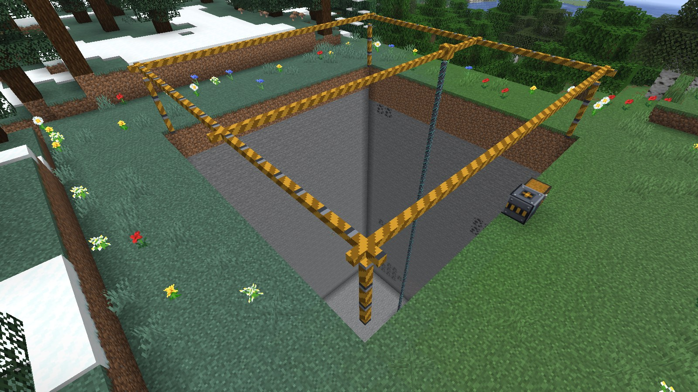
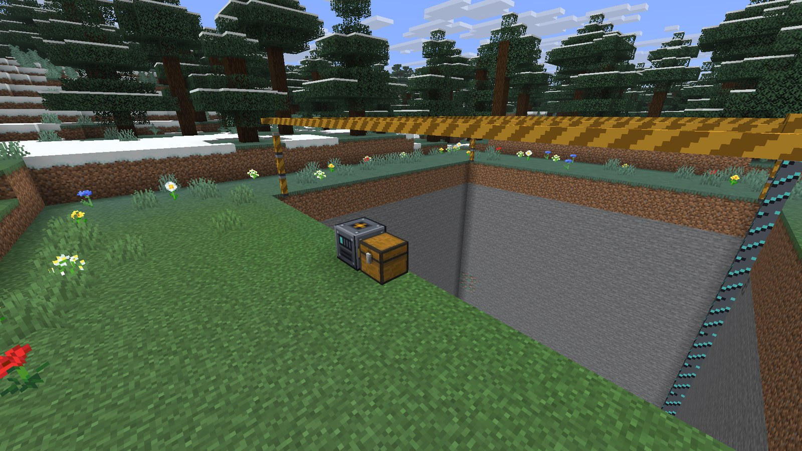
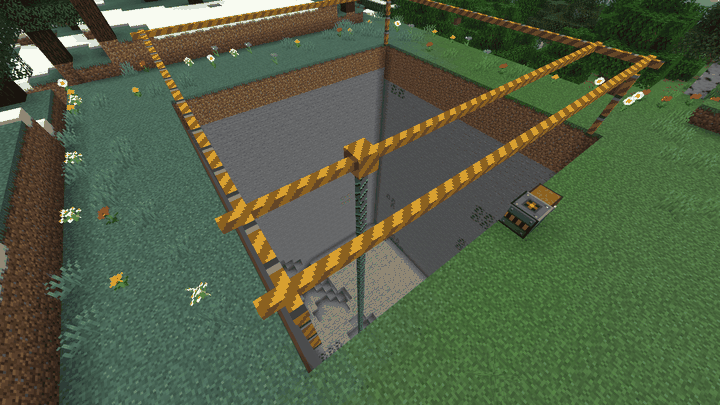
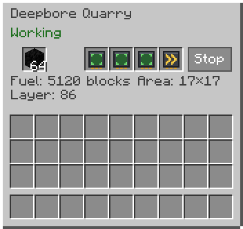
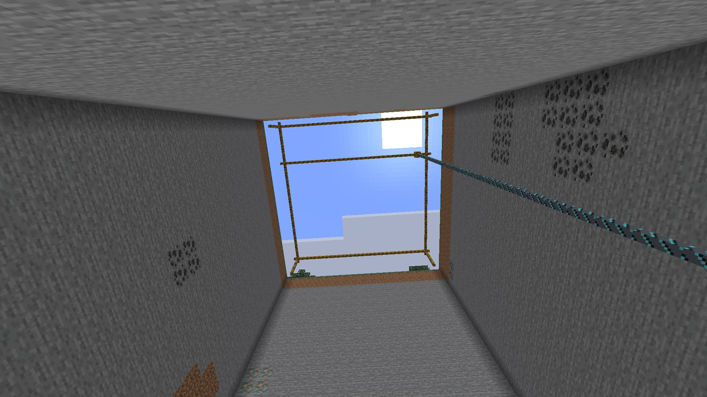
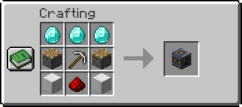
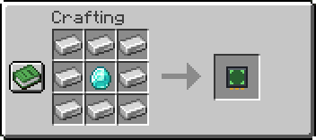
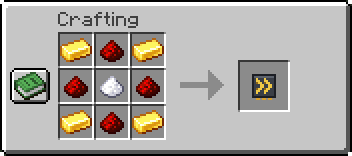
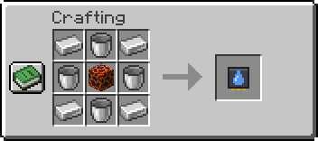
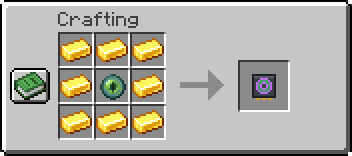

# Deepbore Quarry

A mod for [Horizon](https://github.com/horizon-rust/horizon) (Minecraft: Java Edition 26.3 in Rust). A machine that digs a
square pit down to bedrock on furnace fuel and fills a chest beside it, under a moving gantry with a drill.

> **The mod has two parts, and you need both:**
>
> - `deepbore_quarry_native`: the native part, the code.
> - `deepbore_quarry`: the assets, its textures, text and recipes.
>
> Install both on the launcher's Mods page and press Build. If one is missing, the game says so in chat.

## How to play

1. **Craft** the quarry ([recipes](#recipes)).
2. **Place** it. The pit lies beyond it, the way you are looking, and goes from the quarry's own level down.
3. **Put a chest** against any other side of it. A barrel or a shulker box works too.
4. **Right-click** it, put in fuel, and press Start.

*Sped up.*

Anything a furnace burns is fuel, and a hopper can feed it from any side. One coal digs eight blocks, a block of coal
eighty. Without upgrades the pit is 5×5 and a block takes two seconds, so a 5×5 pit from sea level to bedrock takes up to
400 coal and a little under two hours.

The screen says how much the fuel will dig, how large the pit is and which layer it has reached. It also says why the
quarry stands still: out of fuel, no chest, the chest is full, a fluid in the way, a redstone signal, or a finished pit.
Drops the chest has no room for wait inside the quarry, and nothing lands on the ground.

The quarry digs like an unenchanted diamond pickaxe, so obsidian comes too. It leaves bedrock and any block with
contents, such as chests and furnaces. Air costs nothing; plants cost as much as stone.

Breaking the quarry gives back the quarry, its fuel, its upgrades and any drops still waiting. The pit stays.

## Upgrades

A quarry has four upgrade slots, so you choose what it is good at.

| Upgrade | Most | What it does |
|---|---|---|
| Area | 3 | 5×5, then 9×9, 13×13 and 17×17 |
| Speed | 3 | A block in 2 s, then 1 s, 0.5 s and 0.25 s |
| Fluids | 1 | Plugs water and lava with cobblestone and digs on, instead of stopping |
| Chunk | 1 | Keeps working when you are away, one quarry per player |

A different area starts the pit again from the top. The cells already empty cost nothing.

## Recipes

All on a crafting table.

**Deepbore Quarry:** three diamonds, two pistons, an iron pickaxe, two blocks of iron and redstone.

**Area Upgrade:** eight iron ingots around a diamond.

**Speed Upgrade:** gold ingots and redstone around sugar.

**Fluids Upgrade:** iron ingots and buckets around a magma block.

**Chunk Upgrade:** eight gold ingots around an eye of ender.

## On a server

Only the player who placed a quarry, or an operator, can open or break it.

Operators have two commands:

| Command | What it does |
|---|---|
| `/deepbore maxsize` | Shows the largest area this world allows |
| `/deepbore maxsize <5\|9\|13\|17>` | Sets it |

A quarry over the limit stops and says so. Each world keeps the setting in `horizon-deepbore-quarry/config.json`, in the
world's folder.

## Good to know

- Every player needs both parts of the mod. It runs with your account's permissions, as every native mod does.
- It is pinned to Horizon Nightly 2026-11-04 (67dad0d).
- The gantry is drawn while you are within 64 blocks of the quarry, so it is gone from the bottom of a very deep pit.
- Torches, ladders and doors on what the quarry digs can fall to the ground with their support.
- A container from another mod takes the drops only if its name ends in `chest`, `barrel` or `shulker_box`.
- A dedicated server that pauses when empty (`pause-when-empty-seconds`) pauses the quarry too.

The text is in English and Russian, following the game's language. All the art is original, and no Minecraft code or
assets are included.

## License

MIT
